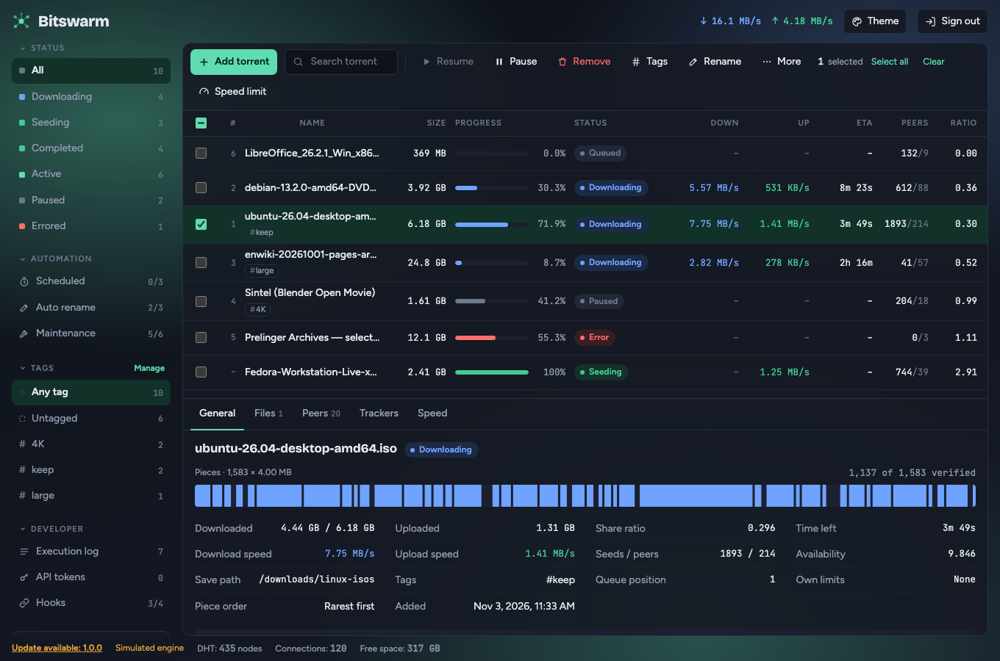
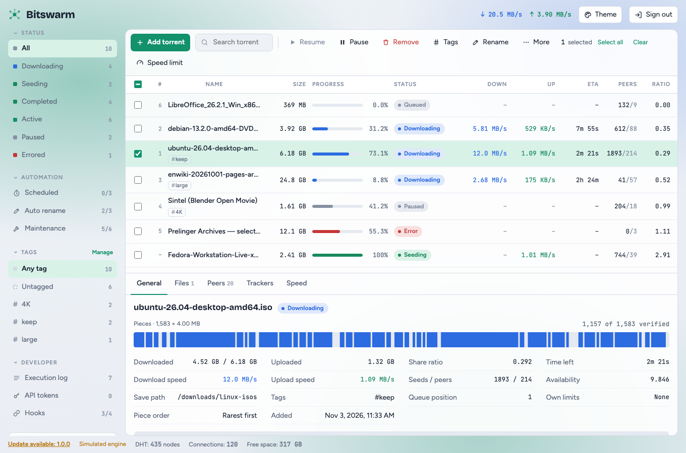
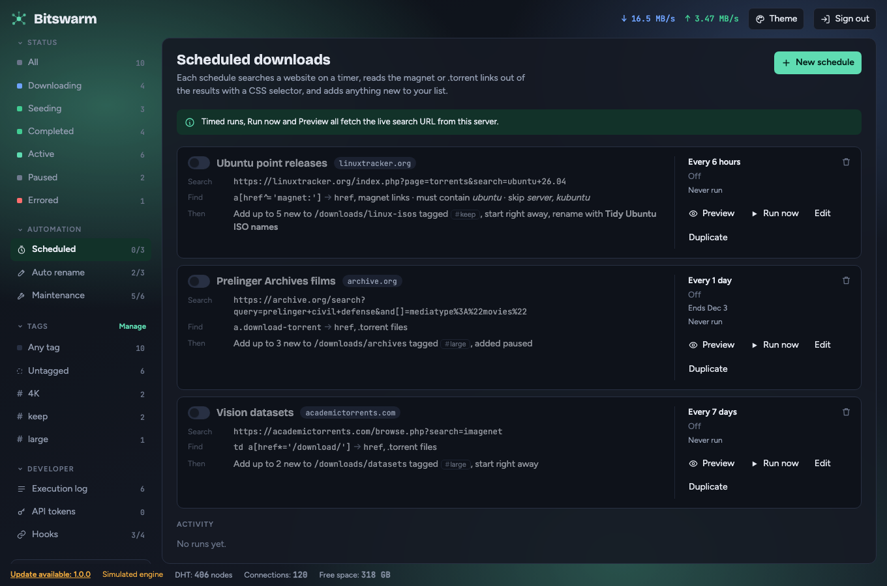
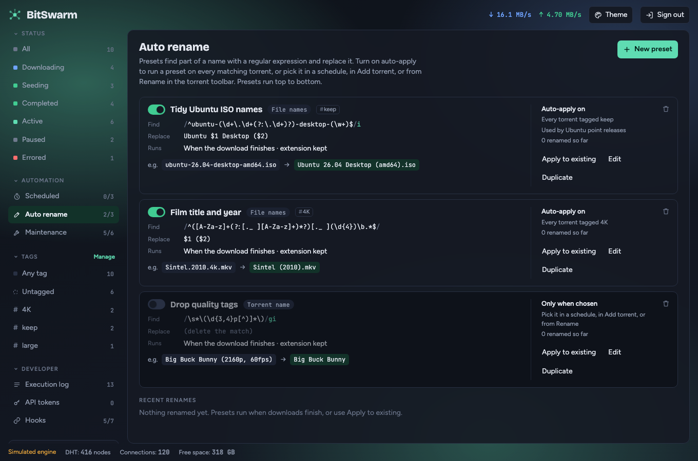
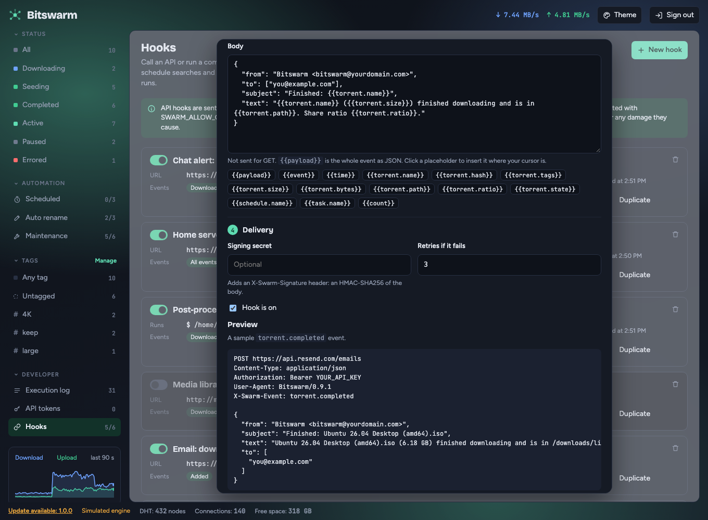
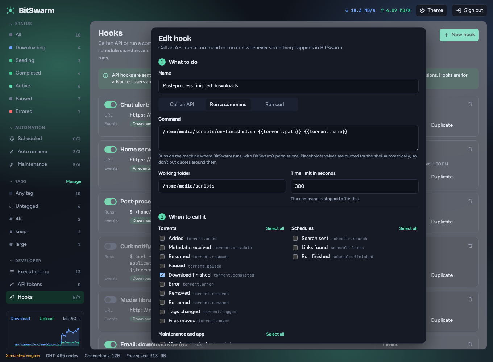

<p align="center"></p>

# Bitswarm

[](https://github.com/bitswarm-dev/bitswarm/releases)
[](https://hub.docker.com/r/dockerkeithics/bitswarm-server)
[](https://hub.docker.com/r/dockerkeithics/bitswarm-server/tags)

Bitswarm is a programmable BitTorrent client with a web interface. Most clients stop once the download finishes: finding new releases, fixing messy file names, sorting files into folders and telling you when something is done are left to you, or to a pile of scripts. Bitswarm makes those steps part of the client.

- **Schedule it:** search websites on a timer and add what's new.
- **Organize it:** rename files with regex rules and move them into folders, so your library stays tidy on its own.
- **Hook it up:** call an API or run a command at every step, from added to finished to failed. Send an email, ping a chat, refresh your media server.
- **Script it:** use API tokens to control Bitswarm from your own code.

> Bitswarm is a general-purpose BitTorrent client. It isn't built for piracy, and it doesn't provide, host or index content. Only download and share what you have the right to. You are responsible for following your local laws. This is not legal advice, and the authors aren't liable for how you use it.

## Contents

- [Screenshots](#screenshots)
- [Automation](#automation)
- [Features](#features)
- [Install](#install)
- [Configuration](#configuration)
- [Not supported yet](#not-supported-yet)
- [Contributing](#contributing)
- [Security](#security)
- [License](#license)

## Screenshots

Captured in demo mode, which uses a simulated engine with sample torrents.

| Dark | Light |
|---|---|
|  |  |

## Automation

### Scheduled downloads

A schedule searches a website on a timer, reads the magnet or `.torrent` links out of the results with a CSS selector, filters them by name, and adds anything new. It can tag what it adds, apply a rename preset and use your default save folder.



### Auto rename

A preset finds part of a name with a regular expression and replaces it. It can run on every finished download that matches a tag, from a schedule, or by hand with a live preview and undo. For files, a `/` in the replacement moves the file into that folder, which is created if it's missing. Regular expressions use Go syntax.



### Hooks

A hook runs when something happens in Bitswarm. Pick the events, pick what to do, and use placeholders such as `{{torrent.name}}`, `{{torrent.path}}` and `{{torrent.size}}` to pass details along.

- **Events:** torrent added, metadata received, resumed, paused, download finished, error, removed, renamed, tags changed and files moved. Also schedule search, links found and run finished, and maintenance task ran, settings saved and update available. A hook can be limited to one tag.
- **Call an API:** send a request to any URL, with your own method, headers and body. Requests are retried when the other side fails. With a signing secret they carry an `X-Swarm-Signature` header, an HMAC-SHA256 of the body, so the receiver can check where they came from.
- **Run a command:** run a script on the machine where Bitswarm runs. It gets the event as environment variables and, if you want, as JSON on its standard input. Placeholder values are quoted for the shell automatically, so a torrent named `x'; rm -rf ~ #` arrives as one plain argument. Command hooks are off until you start the server with `SWARM_ALLOW_COMMANDS=1`, and in Docker they run inside the server container.
- **Test before you trust it:** every hook has a Send test button and a preview of the exact request. Recent deliveries are listed on the Hooks page, with their status, so you can see what was sent, or "Not sent" and "Not run" when it wasn't.

**Call an API.** The editor for the email example below, with the request preview at the bottom:



**Run a command.** The same editor for a script that runs when a download finishes:



Command hooks can do anything the server user can do, and API hooks send data off your machine. Use hooks at your own risk, and read the warning on the Hooks page.

#### Example: email when a download starts and finishes

Use any email service that sends mail from a JSON request. This example uses the Resend API. Create two API hooks with **Hooks → New hook → Call an API**. Both use method `POST`, the URL `https://api.resend.com/emails` and these headers:

```text
Content-Type: application/json
Authorization: Bearer {{secret.RESEND_KEY}}
```

`{{secret.RESEND_KEY}}` keeps your API key out of Bitswarm's database. See [Keep keys out of the database](#keep-keys-out-of-the-database) below for how to set it.

**Email: download started.** Tick the event **Added**, and use this body:

```json
{
  "from": "Bitswarm <bitswarm@yourdomain.com>",
  "to": ["you@example.com"],
  "subject": "Started: {{torrent.name}}",
  "text": "Bitswarm started {{torrent.name}} ({{torrent.size}}). It will be saved to {{torrent.path}}."
}
```

**Email: download finished.** Tick the event **Download finished**, and use this body:

```json
{
  "from": "Bitswarm <bitswarm@yourdomain.com>",
  "to": ["you@example.com"],
  "subject": "Finished: {{torrent.name}}",
  "text": "{{torrent.name}} ({{torrent.size}}) finished downloading and is in {{torrent.path}}. Share ratio {{torrent.ratio}}."
}
```

Notes:

- Placeholder values are escaped for JSON automatically, so a torrent name with quotes can't break the request.
- For a magnet link, the name and size may not be known when the torrent is added. Tick **Metadata received** instead of **Added** to send the email once they are.
- Press **Send test** to send a sample event first. The preview under the form shows the request before anything leaves your machine.
- Use an API key that can only send email, and rotate it if it ever leaks.
- Replace `from` with an address your email service has verified. To send through a different service, change the URL, the headers and the body to match its API.

#### Keep keys out of the database

Write `{{secret.NAME}}` anywhere in an API hook's URL, headers or body. When Bitswarm sends the request, it reads the value from the server's environment variable `SWARM_SECRET_NAME`, or from the file named by `SWARM_SECRET_NAME_FILE` (handy for Docker secrets). Names use capital letters, digits and underscores, and start with a letter.

- The value is never saved with the hook. The editor, the API, the delivery history, the logs and backups only ever show `{{secret.NAME}}`.
- If the variable isn't set, the hook doesn't send and says which one is missing. The editor warns you too.
- Command hooks can't use it. A script can read its own file instead.

In Docker, put the key in a `.env` file next to `docker-compose.yml`, and pass it to the server with a `docker-compose.override.yml`. Compose picks the override file up on its own:

```text
SWARM_SECRET_RESEND_KEY=re_your_key_here
```

```yaml
services:
  server:
    environment:
      SWARM_SECRET_RESEND_KEY: ${SWARM_SECRET_RESEND_KEY}
```

Then run `docker compose up -d`. If you type a key straight into a header instead, Bitswarm hides it in the editor and the API after you save, but it is still stored as plain text in the database file. Use `{{secret.NAME}}` when you can.

### API tokens

Create Bearer tokens with read, control or admin access on the **API tokens** page, and use them against `/api/v1` from your own scripts.

## Features

- **Torrents:** add by magnet link or `.torrent` file, pick which files to download, set per-file priorities, pause, resume, recheck, move files, rename on disk, queue, force start, global and alternative (scheduled) speed limits, seeding limits, restart recovery.
- **Tags:** group and filter torrents with tags. A torrent can have many.
- **Scheduled downloads:** search a site on a timer, read magnet or `.torrent` links with a CSS selector, filter by name, and add the new ones. Schedules can apply tags and a rename preset, and use the default save folder from Settings.
- **Auto rename:** regex presets (Go syntax) with a live preview, undo, and per-tag scope.
- **Maintenance:** six housekeeping tasks (retry errors, remove finished, handle stalled, low disk space, verify, clear old activity).
- **Hooks:** call an API (HMAC-signed, retried) or run a command on any event. Commands stay off unless you start the server with `SWARM_ALLOW_COMMANDS=1`.
- **API tokens:** Bearer tokens with read, control or admin access, under `/api/v1`.
- **Backup:** export and import settings, theme, tags, schedules, presets, maintenance tasks and hooks as JSON.
- **Interface:** light and dark themes, accent colors, background images, adjustable panel opacity, and a phone layout.

## Install

### Docker (recommended)

You only need [Docker](https://docs.docker.com/get-docker/) with Compose.

```sh
mkdir bitswarm && cd bitswarm
curl -fsSLO https://raw.githubusercontent.com/bitswarm-dev/bitswarm/main/docker-compose.yml
mkdir data downloads
sudo chown 10001:10001 data downloads
docker compose up -d
```

Then open <http://localhost:8080>. The default login is `admin` / `swarm`. **Change it right away** in Settings → Web UI.

The images [`dockerkeithics/bitswarm-server`](https://hub.docker.com/r/dockerkeithics/bitswarm-server) and [`dockerkeithics/bitswarm-web`](https://hub.docker.com/r/dockerkeithics/bitswarm-web) are published for `linux/amd64`, `linux/arm64`, `linux/arm/v7` and `linux/386`. Two Alpine-based containers run: `server` (the Go service with the BitTorrent engine) and `web` (nginx serving the dashboard and proxying `/api` to the server).

- **Sign-in is always required** in Docker, because the server sees nginx as the client and not localhost.
- **The web port is bound to `127.0.0.1` by default.** To reach it from other machines, set `SWARM_BIND=0.0.0.0` and put it behind HTTPS.
- **Data:** the database and engine state live in `./data` (change it with `SWARM_DATA_DIR`). Downloads go to `./downloads` (change it with `SWARM_DOWNLOADS_DIR`). Both folders must be writable by user ID 10001, which is what the `chown` step does. Without it, Docker creates them owned by root and the server can't start on Linux. Docker Desktop on macOS and Windows doesn't need the `chown`. Don't open the folders up with `chmod 777`: the data folder holds your database, and Bitswarm makes the database file readable by its owner only. To back it up, use Settings → Backup, or copy it with `sudo`.
- **Peers:** port 51413 (TCP and UDP) is published for peer connections. If that port is taken, set `SWARM_PEER_PORT` (for example `51414`), set the same listening port in Settings, and restart. The host and container ports must match so peers can reach you. UPnP can't open ports from inside a container, so forward the port on your router if you need incoming connections.
- **Versions:** the compose file pulls the latest stable release. To pin a version, set `SWARM_VERSION` (for example `SWARM_VERSION=0.9.1`) and run `docker compose pull && docker compose up -d` to update. Each release also has a `docker-compose.yml` already pinned to its version. Per-platform tags such as `0.9.1-amd64` exist too.
- **Other options** (set in your shell or a `.env` file): `SWARM_WEB_PORT` (default 8080), `SWARM_PEER_PORT` (default 51413), `SWARM_DATA_DIR`, `SWARM_DOWNLOADS_DIR`, `SWARM_DEMO`, `SWARM_ALLOW_COMMANDS`, `SWARM_UPDATE_FEED`, `LOG_LEVEL`. Commands run by hooks would run inside the server container.
- `docker compose down` keeps your data. Your `data` and `downloads` folders are not touched.
- **Build the images yourself** from this source instead of pulling them:

  ```sh
  docker compose -f docker-compose.yml -f docker-compose.build.yml up -d --build
  ```

### Release downloads

Each [GitHub release](https://github.com/bitswarm-dev/bitswarm/releases) has server binaries for Linux (amd64, arm64, armv7, 386), macOS (amd64, arm64) and Windows (amd64, arm64), the built dashboard, and `SHA256SUMS`. Check the download against `SHA256SUMS` before you run it.

The server binary serves the API on port 8080. It doesn't serve the dashboard. Put the dashboard files behind any web server that proxies `/api` to the server. The Docker setup does this for you with nginx.

### Run from source

You need [Go](https://go.dev/dl/) 1.26 or newer and [Node.js](https://nodejs.org/) with npm.

```sh
./run.sh
```

Then open <http://localhost:5173>. The script builds the server, starts it on port 8080, starts the dashboard (Vite proxies `/api` to the server) and stops both when you press Ctrl-C.

A fresh database is empty. Downloads go to `server/downloads`, or the folder in `SWARM_DOWNLOADS`. Sign-in is skipped on localhost by default (Settings → Web UI). When it's on, the default login is `admin` / `swarm`.

### Demo mode

```sh
./run.sh --demo
```

Demo mode uses a **simulated** engine with 10 sample torrents. Nothing is downloaded, and the interface says so.

## Configuration

The server reads these environment variables:

| Variable | Default | What it does |
|---|---|---|
| `PORT` | `8080` | Server port |
| `DB_PATH` | `data/swarm.db` | SQLite file. The engine keeps its state in an `engine/` folder next to it. |
| `SWARM_DOWNLOADS` | `./downloads` | Default save folder |
| `SWARM_DEMO` | off | `1` switches to the simulated engine with sample data |
| `SWARM_ALLOW_COMMANDS` | off | `1` lets command hooks run on this machine |
| `SWARM_UPDATE_FEED` | none | URL of a release feed for the update check |
| `SWARM_SECRET_<NAME>` | none | A secret for API hooks. Write `{{secret.NAME}}` in a hook to use it. `SWARM_SECRET_<NAME>_FILE` reads it from a file instead. |
| `LOG_LEVEL`, `LOG_FORMAT` | | Logging |

Everything else (save paths, limits, queueing, Web UI login) is in the Settings page.

## Not supported yet

The interface tells you where these apply:

- Per-torrent speed limits, sequential download, and first and last pieces first. The server refuses them.
- Skip hash check. Existing files are always verified.
- Tracker status. The Trackers tab lists URLs only.
- Applying port, UPnP, DHT and encryption changes without a restart. Connection limits, upload slots, proxy, PEX, LSD, uTP and the Web UI port, HTTPS and proxy settings are saved but not used yet.
- Automated tests for the dashboard. The Go side has tests, including a loopback peer-to-peer engine test.

## Contributing

Issues and pull requests are welcome. For anything bigger than a small fix, open an issue first so we can agree on the approach.

```
run.sh              starts the server and the dashboard
docker-compose.yml  runs the published images (docker-compose.build.yml builds them from source)
CLAUDE.md           rules for people and AI agents working on the code
server/             Go service: Fiber, SQLite, built-in BitTorrent engine
dashboard/          React 18, TypeScript, Vite, TanStack Query
```

Read [`CLAUDE.md`](./CLAUDE.md) first. It has the conventions, the event catalog and the design rules. Before you open a pull request, make sure these pass:

```sh
cd server && go build ./... && go vet ./... && go test ./... -race
cd dashboard && npx tsc -b --noEmit && npx vite build
```

UI changes also need a check in a real browser, in light and dark themes, at desktop and phone width. For end-to-end checks against real torrents and a real website (Debian's netinst images, with checksums), see "Testing the real engine" in [`CLAUDE.md`](./CLAUDE.md). Run test servers with their own `DB_PATH` and `SWARM_DOWNLOADS`, and delete your test data afterwards.

## Security

Bitswarm can run commands and call URLs through hooks, so treat access to it like shell access to the host. Change the default password, keep the port on localhost or behind HTTPS, and leave command hooks off unless you need them.

How secrets are handled:

- **Web password:** stored only as a PBKDF2-SHA256 hash with a random salt.
- **API tokens:** shown once when you create them. Only a SHA-256 hash and the last 4 characters are kept.
- **API keys for hooks:** use `{{secret.NAME}}` so the key lives in the server's environment and never in the database. A key typed into a header such as `Authorization` or `X-Api-Key` is hidden in the editor, the API and the delivery history after you save, but it is stored as plain text in the database file.
- **Hook signing secrets:** stored, because Bitswarm needs them to sign, but never sent back to the browser.
- **The database file:** readable by its owner only (`0600`).
- **Backups:** secrets are left out unless you tick "include secrets". Real keys in secret-looking headers (`Authorization`, `X-Api-Key`, `Cookie` and similar) are blanked, and `{{secret.NAME}}` references are kept.
- **Errors and logs:** addresses are shown without their query string, so a key in `?apikey=…` doesn't end up in the log.
- **Not covered:** a key placed in a URL, a body or a custom-named header is not recognized as secret. Put it in `{{secret.NAME}}`.

To report a vulnerability, open a private security advisory on the GitHub repository. Please don't post it in a public issue.

## License

Bitswarm is licensed under the [PolyForm Noncommercial License 1.0.0](./LICENSE). You can use it, change it and share it for free for any noncommercial purpose: personal use, hobby projects, research and study, and use by charities, schools and public institutions. You can't sell it or use it for commercial purposes, including running it inside a for-profit business.

This is a source-available license, not an OSI-approved open source license, because it limits commercial use. If you want to use Bitswarm commercially, open an issue to ask.

Third-party libraries keep their own licenses. They are listed in [THIRD_PARTY_NOTICES.md](./THIRD_PARTY_NOTICES.md), which also ships in the release downloads.
