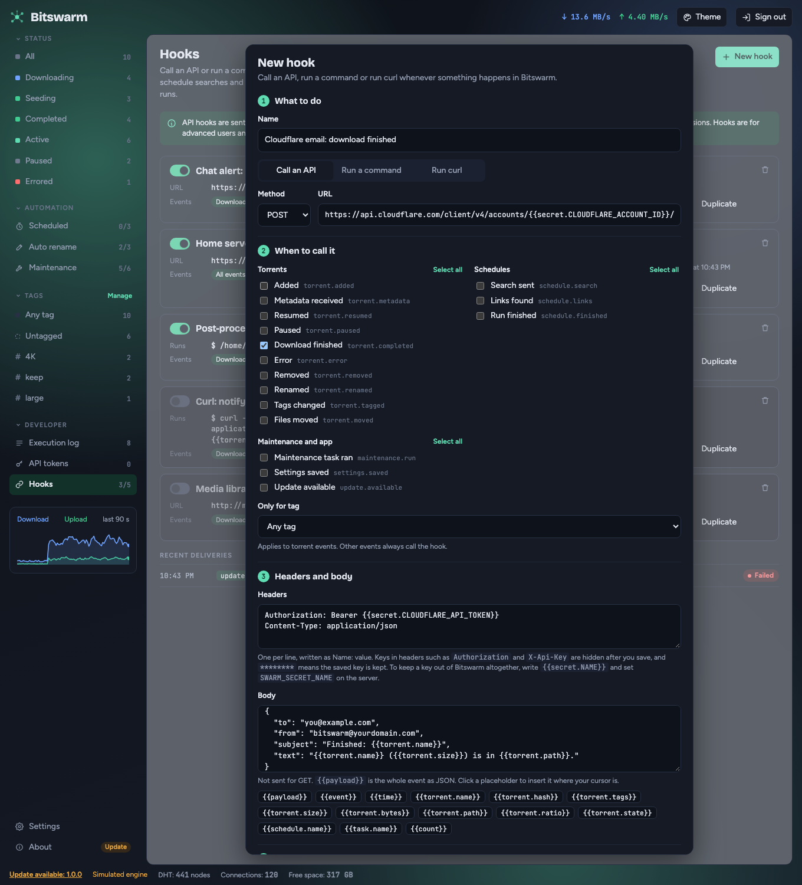

# Hook recipes

Copy-paste API hooks for common services. Each one keeps its keys out of BitSwarm's database with `{{secret.NAME}}`, so the hook you save only ever holds the name. See [Keep keys out of the database](../README.md#keep-keys-out-of-the-database) for how BitSwarm reads the values.

**How to use a recipe**

1. Set the environment variables listed under **Secrets** on the server, then restart BitSwarm. In Docker, put them in a `.env` file and pass them through `docker-compose.override.yml`, as the README shows.
2. Go to **Hooks → New hook → Call an API** and copy the method, URL, headers and body.
3. Pick the events in step 2, press **Send test**, and check the preview first. The editor warns you about any secret that isn't set.

Placeholders such as `{{torrent.name}}` are escaped for the place they land: URL encoding in the URL, JSON string escaping in a JSON body. A torrent name with quotes can't break the request.

Every recipe uses **Download finished** (`torrent.completed`). Change the events to suit you. These are examples for each service's public API, so check the service's own documentation if a request is refused.

---

## Cloudflare Email Service

Sends an email through Cloudflare.

**Secrets:** `SWARM_SECRET_CLOUDFLARE_ACCOUNT_ID`, `SWARM_SECRET_CLOUDFLARE_API_TOKEN`

| | |
|---|---|
| Method | `POST` |
| URL | `https://api.cloudflare.com/client/v4/accounts/{{secret.CLOUDFLARE_ACCOUNT_ID}}/email/sending/send` |

Headers:

```text
Authorization: Bearer {{secret.CLOUDFLARE_API_TOKEN}}
Content-Type: application/json
```

Body:

```json
{
  "to": "you@example.com",
  "from": "bitswarm@yourdomain.com",
  "subject": "Finished: {{torrent.name}}",
  "text": "{{torrent.name}} ({{torrent.size}}) is in {{torrent.path}}."
}
```

Use a `from` address on a domain you have set up for sending. Create the API token with only the permission it needs.



## Resend

**Secrets:** `SWARM_SECRET_RESEND_KEY`

| | |
|---|---|
| Method | `POST` |
| URL | `https://api.resend.com/emails` |

Headers:

```text
Authorization: Bearer {{secret.RESEND_KEY}}
Content-Type: application/json
```

Body:

```json
{
  "from": "BitSwarm <bitswarm@yourdomain.com>",
  "to": ["you@example.com"],
  "subject": "Finished: {{torrent.name}}",
  "text": "{{torrent.name}} ({{torrent.size}}) finished downloading and is in {{torrent.path}}."
}
```

## Discord

The webhook address is itself a secret, because anyone who has it can post to your channel. Copy only the part after `https://discord.com/api/webhooks/`.

**Secrets:** `SWARM_SECRET_DISCORD_WEBHOOK` (for example `123456789/abcDEF...`)

| | |
|---|---|
| Method | `POST` |
| URL | `https://discord.com/api/webhooks/{{secret.DISCORD_WEBHOOK}}` |

Headers:

```text
Content-Type: application/json
```

Body:

```json
{
  "content": "Finished **{{torrent.name}}** ({{torrent.size}})"
}
```

## Slack

**Secrets:** `SWARM_SECRET_SLACK_WEBHOOK` (the part of the incoming webhook address after `https://hooks.slack.com/services/`, such as `T000/B000/XXXX`)

| | |
|---|---|
| Method | `POST` |
| URL | `https://hooks.slack.com/services/{{secret.SLACK_WEBHOOK}}` |

Headers:

```text
Content-Type: application/json
```

Body:

```json
{
  "text": "Finished: {{torrent.name}} ({{torrent.size}})"
}
```

## Telegram

**Secrets:** `SWARM_SECRET_TELEGRAM_BOT_TOKEN`, `SWARM_SECRET_TELEGRAM_CHAT_ID`

| | |
|---|---|
| Method | `POST` |
| URL | `https://api.telegram.org/bot{{secret.TELEGRAM_BOT_TOKEN}}/sendMessage` |

Headers:

```text
Content-Type: application/json
```

Body:

```json
{
  "chat_id": "{{secret.TELEGRAM_CHAT_ID}}",
  "text": "Finished: {{torrent.name}} ({{torrent.size}})"
}
```

## ntfy

Sends a push notification to a topic. Treat a topic name on a public server like a password.

**Secrets:** `SWARM_SECRET_NTFY_TOPIC`

| | |
|---|---|
| Method | `POST` |
| URL | `https://ntfy.sh/{{secret.NTFY_TOPIC}}` |

Headers:

```text
Title: Download finished
Content-Type: text/plain
```

Body:

```text
{{torrent.name}} ({{torrent.size}}) is in {{torrent.path}}
```

For a server you host, change the URL to your own address. If it needs a login, add `Authorization: Bearer {{secret.NTFY_TOKEN}}` and set `SWARM_SECRET_NTFY_TOKEN`.

## Pushover

**Secrets:** `SWARM_SECRET_PUSHOVER_TOKEN`, `SWARM_SECRET_PUSHOVER_USER`

| | |
|---|---|
| Method | `POST` |
| URL | `https://api.pushover.net/1/messages.json` |

Headers:

```text
Content-Type: application/json
```

Body:

```json
{
  "token": "{{secret.PUSHOVER_TOKEN}}",
  "user": "{{secret.PUSHOVER_USER}}",
  "title": "Download finished",
  "message": "{{torrent.name}} ({{torrent.size}})"
}
```

## Gotify

**Secrets:** `SWARM_SECRET_GOTIFY_TOKEN`

| | |
|---|---|
| Method | `POST` |
| URL | `https://gotify.example.org/message` (your own server) |

Headers:

```text
X-Gotify-Key: {{secret.GOTIFY_TOKEN}}
Content-Type: application/json
```

Body:

```json
{
  "title": "Download finished",
  "message": "{{torrent.name}} ({{torrent.size}})",
  "priority": 5
}
```

## Your own server, signed

For a service you run yourself, send the whole event and let the receiver check it. Enter a **Signing secret** in step 4 of the editor, and BitSwarm adds an `X-Swarm-Signature` header, an HMAC-SHA256 of the body.

| | |
|---|---|
| Method | `POST` |
| URL | `https://home.example.net/api/swarm/events` |

Headers:

```text
Content-Type: application/json
Authorization: Bearer {{secret.HOME_API_TOKEN}}
```

Body:

```text
{{payload}}
```

**Secrets:** `SWARM_SECRET_HOME_API_TOKEN`

---

## Run curl or a command instead

Command and curl hooks can't use `{{secret.NAME}}`, and they only see `PATH` and `HOME` from BitSwarm's environment, not the variables in your shell. For those, let the script read its own key from a file it controls. If the service has an HTTP API, a **Call an API** hook with a secret is the simpler and safer choice.
