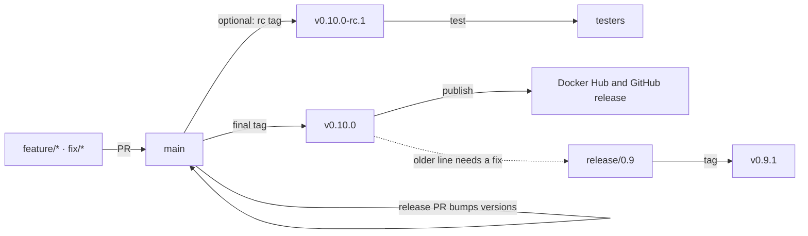

# Releasing Bitswarm

The core rule: **branches are where you work, tags are what you ship.** `main` is always releasable. A release is a version tag on `main`. Never move or reuse a tag.

## Branches

| Branch | Purpose |
|---|---|
| `main` | Always releasable. Reviewed work lands here through pull requests, and releases are tagged from it. |
| `feature/*`, `fix/*` | Short-lived work branches. Branch from `main`, merge back with a pull request. |
| `release/X.Y` | Created only when you must patch an older version after `main` has moved on. Cut it from that version's tag. |

## Tags

| Tag | Meaning |
|---|---|
| `vX.Y.Z-rc.N` | Release candidate for testing. Pre-release: Docker tags `X.Y.Z-rc.N`, no `latest`. |
| `vX.Y.Z` | Final release. Docker tags `X.Y.Z` plus per-platform tags. It takes `latest` only if it is the highest stable version. |

## Cut a release

1. **Land the work in `main`.** Pull requests merge once the checks pass.
2. **Open a release pull request** that bumps the version in three places, then merge it:
   - `dashboard/src/pages/about/About.tsx` (`VERSION`)
   - `docker-compose.yml` (the `SWARM_VERSION` default)
   - `README.md` (the pinned version in the Docker section)

   Use the final version, for example `0.10.0`, even if you plan a release candidate first.
3. **Optional: test a release candidate.** Tag the merge commit `v0.10.0-rc.1` and push the tag. Fix problems with normal pull requests to `main`, then tag `rc.2`, `rc.3` and so on.
4. **Tag the final release** on the commit you tested and push the tag:

   ```text
   main → v0.10.0
   ```

5. **Check the result.** The GitHub release exists, the Docker Hub tags `0.10.0` and `latest` list all four platforms, and the assets are attached.

## Patch an older version

Do this only when users on an older line need a fix and `main` has already moved on.

1. **Fix it in `main` first**, through a normal pull request.
2. **Create `release/0.9`** from the old tag (`v0.9.0`) if it doesn't exist yet.
3. **Cherry-pick the fix** onto it, and bump the three version places to `0.9.1` in the same pull request.
4. **Tag `v0.9.1` on `release/0.9`** and push the tag.

A patch to an older line never takes `latest`. If the bug exists only in the old line, fix it on the release branch and forward-port the fix to `main`, so it doesn't come back in the next release.

## What the pipeline checks

Pushing a tag runs `.github/workflows/docker-release.yml`. It stops, with a plain message, if:

- the tag isn't `vX.Y.Z` or `vX.Y.Z-rc.N`
- the tagged commit isn't on `main` or on `release/X.Y`
- `About.tsx` or `docker-compose.yml` doesn't match the version being released

Then it creates the GitHub release (a pre-release for `-rc` tags), pushes the multi-arch and per-platform Docker images for `linux/amd64`, `arm64`, `arm/v7` and `386`, and attaches the server binaries, the dashboard, `docker-compose.yml` and `SHA256SUMS`.

## Rules

- **Tags are immutable.** A fix gets a new tag (`v0.10.1`), never a re-tagged `v0.10.0`.
- **Fix `main` first.** Backport to older lines by cherry-picking the fix. Never merge a release branch into `main` wholesale or `main` into a release branch.
- **Users run final tags.** Release candidates are for testing only.

## Release flow


