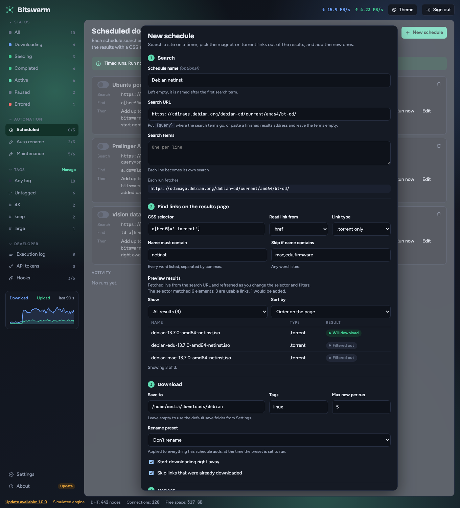
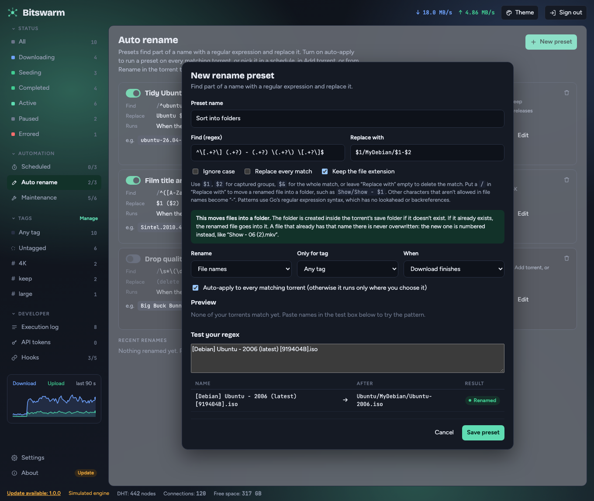

# Scheduled download recipes

Copy-paste settings for **Scheduled** downloads. A schedule fetches a page on a timer, reads the magnet or `.torrent` links out of it with a CSS selector, keeps the ones whose names match your filters, and adds anything it hasn't seen before. See [Scheduled downloads](../README.md#scheduled-downloads) for the overview.

Bitswarm doesn't provide or index content. Point a schedule only at sites you are allowed to download from, and follow your local laws.

**How to use a recipe**

1. Go to **Scheduled → New schedule** and copy the values from the table into the matching fields.
2. Check **Preview results** under step 2. It fetches the live page and shows what the selector and filters match, and it refreshes as you change them. Don't save until the list looks right.
3. Set **Run every** in step 4, and optionally tags, a save folder and a rename preset in step 3. An empty **Save to** uses the default folder from Settings.
4. Leave **Skip links that were already downloaded** on, so each link is added once.

Bitswarm waits between searches (Settings → "Wait between searches", 5 seconds by default), so a long list of search terms is spread out and doesn't hammer the site.

---

## A Linux ISO from a distribution's download page

This one needs no search terms. The page lists the files, and the schedule picks the one you want. It is the same check Bitswarm's own end-to-end test uses, and you can verify the result against the publisher's `SHA256SUMS`.

| Field | Value |
|---|---|
| Schedule name | `Debian netinst` |
| Search URL | `https://cdimage.debian.org/debian-cd/current/amd64/bt-cd/` |
| Search terms | *(leave empty)* |
| CSS selector | `a[href$='.torrent']` |
| Read link from | `href` |
| Link type | `.torrent only` |
| Name must contain | `netinst` |
| Skip if name contains | `mac,edu,firmware` |
| Max new per run | `1` |
| Run every | `7` `days` |

The page also lists Debian Edu, Mac and firmware images, and the filters leave those out. When Debian publishes a new point release, the file name changes, so the schedule sees it as new and adds it.



## Ubuntu Server

| Field | Value |
|---|---|
| Schedule name | `Ubuntu Server 24.04` |
| Search URL | `https://releases.ubuntu.com/24.04/` |
| Search terms | *(leave empty)* |
| CSS selector | `a[href$='.torrent']` |
| Read link from | `href` |
| Link type | `.torrent only` |
| Name must contain | `live-server` |
| Skip if name contains | *(leave empty)* |
| Max new per run | `1` |
| Run every | `7` `days` |

The folder lists several point releases of the same image (24.04.3, 24.04.4, 24.04.5). With **Max new per run** at `1`, the schedule adds one per run until it has them all. Look at the preview, and set **Skip if name contains** to the versions you don't want, such as `24.04.3,24.04.4`.

## Search a site with a list of searches

Use this when a site has a search page that returns magnet links. Each line in **Search terms** becomes its own search. Put `{query}` in the address where the search words go, and write one search per line in **Search terms**. Each line is fetched separately, one after the other.

| Field | Value |
|---|---|
| Schedule name | `My ISO list` |
| Search URL | `https://tracker.example.org/search?q={query}` |
| Search terms | one search per line (see below) |
| CSS selector | `a[href^='magnet:']` |
| Read link from | `href` |
| Link type | `Magnet only` |
| Name must contain | `amd64` |
| Skip if name contains | `beta,arm64` |
| Max new per run | `5` |
| Run every | `6` `hours` |

Search terms:

```text
debian netinst
ubuntu server
fedora workstation
```

- Replace `tracker.example.org` with a site you may use. Open its search in your browser, copy the address, and swap the search words for `{query}`.
- The selector depends on the site's HTML. `a[href^='magnet:']` matches every magnet link on the page. If the page has other magnet links you don't want, narrow it, for example `table.results a[href^='magnet:']`. Check the preview.
- **Name must contain** needs every word listed, separated by commas. **Skip if name contains** drops a link if it has any word listed.
- Search words are URL-encoded for you, so a line with spaces or punctuation works.

## One page of results, no search terms

If you already have the address of a results page, such as a saved search or a feed-like listing, paste it as the **Search URL** and leave **Search terms** empty. Bitswarm fetches that one address on each run.

| Field | Value |
|---|---|
| Search URL | `https://tracker.example.org/browse?category=books&sort=date` |
| Search terms | *(leave empty)* |
| CSS selector | `a[href$='.torrent']` |
| Link type | `.torrent only` |
| Max new per run | `3` |
| Run every | `1` `days` |

## Tidy names as they download: a rename preset

Release names often look like `[Debian] Ubuntu - 2006 (latest) [919404B].iso`: a group in brackets, a title, a number, a label in parentheses and a hash in brackets. A rename preset can sort each file into a folder named after the title. Create it under **Auto rename**, or inline from the schedule's **Rename preset** field.

| Field | Value |
|---|---|
| Preset name | `Sort into folders` |
| Find (regex) | `^\[.+?\] (.+?) - (.+?) \(.+?\) \[.+?\]$` |
| Replace with | `$1/MyDebian/$1-$2` |
| Ignore case | off |
| Replace every match | off |
| Keep the file extension | on |
| Rename | File names |
| Only for tag | Any tag |
| When | Download finishes |
| Auto-apply to every matching torrent | on |

Type the sample name into **Test your regex** and check the result before you save:

| Name | After | Result |
|---|---|---|
| `[Debian] Ubuntu - 2006 (latest) [919404B].iso` | `Ubuntu/MyDebian/Ubuntu-2006.iso` | Renamed |



How it reads:

- `^\[.+?\] ` skips the first bracket, whatever is in it.
- `(.+?) - (.+?)` captures the title as `$1` and the number as `$2`.
- ` \(.+?\) \[.+?\]$` skips the parentheses and the last bracket, whatever is in them.
- In **Replace with**, `MyDebian` is plain text, a folder name you choose. The `/` moves the file into a folder inside the torrent's save folder, and Bitswarm creates the folders if they don't exist. The result is `Ubuntu/MyDebian/Ubuntu-2006.iso`.

Things to know:

- Every part is `.+?`, which matches any text, so it keeps working when the group tag, the label in the parentheses or the hash look different, such as `(latest)` or `(100)`, or `[919404B]` or `[A1B2C3D]`. Strict patterns such as `\d\d` or `[0-9A-F]+` stop matching when a name differs a little.
- With **Keep the file extension** on, the pattern is tested against the name without `.iso`, so end it with the closing `]` and don't put the extension in it.
- A title that itself contains ` - ` is split at the first one.
- Bitswarm uses Go's regular expression syntax: no lookahead and no backreferences.
- A file that already has the new name is numbered, like `Ubuntu-2006 (2).iso`, and never overwritten.

## Extras that work with any recipe

- **Tags.** A schedule can tag what it adds, so you can filter the torrent list by tag and scope rename presets, maintenance tasks and hooks to it.
- **Rename preset.** Pick one, or create one inline, to tidy names as torrents are added.
- **Stop after.** Ends the schedule on a date you pick, for a season or a project.
- **Tell yourself.** Add a [hook](hook-recipes.md) on **Run finished** (`schedule.finished`) or **Links found** (`schedule.links`) to get a message when a schedule adds something. Use `{{schedule.name}}` and `{{count}}` in the text.
